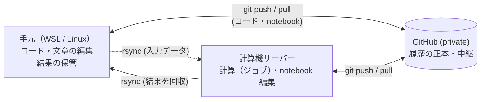

# lab-workflow 全体像（1枚）

> 目的: 研究で使う **手元（WSL/Linux）⇄ 計算機サーバー ⇄ GitHub** の置き場所・運び方・守り方を、初学者が「お箸の持ち方」から身につけ、すでに散らかっている人も手直しできるようにする。
> このページは地図。細部は各章にある。

---

## 1. 理想の状態（ゴール）

### 1.1 3つの拠点と、運ぶもの

- **コードと notebook は git、データと結果は rsync。**（道具は種類で決める）
- 秘密鍵は**手元だけ**。サーバーでは `ssh -A` で借りる。
- サーバーの**ログインノードでは計算しない**。計算は必ずジョブスケジューラ経由（[運用ルール](03-operate/01-server-rules.md)）。

### 1.2 ホームの形（疑似ルート）
```text
~/
├── projects/    計算を伴う研究プロジェクト（1つ = 1ディレクトリ = 1リポジトリ）。名前は小文字とハイフン
├── writing/     計算に直接ひも付かない文章（申請書・スライド・レポート）
├── notes/       メモ・議事録
├── src/         他人のリポジトリ（読むだけ）
├── archive/     終わったもの。消さずに退避
└── .bashrc, .ssh/, miniconda3/ ...   ツールの管理物（基本は触らない）
```
プロジェクトの中身（`templates/` と `bin/init-project.sh` が雛形）:
```text
projects/<name>/
├── src/ scripts/ config/ docs/ paper/   コード・設定・文章（手元で編集）
├── notebooks/                           対話的に触る notebook（サーバーで編集）
├── data/  runs/  results/               大きいもの。Git に入れない
├── environment.yml                      環境の宣言。Git に入れる
└── README.md  .gitignore  .gitattributes
```

### 1.3 「できている」かの判定 → `bin/doctor.sh` が読み取りだけで確認する
- [ ] ホーム直下が骨格＋ツール置き場だけ
- [ ] 全プロジェクトが Git 管理で、private の remote があり、名前が3拠点で一致
- [ ] 未 commit・未 push が溜まっていない／大きなファイル・秘密が履歴に無い
- [ ] サーバーに秘密鍵が無い／commit のメールが全拠点で同じ noreply
- [ ] 結果に run_id が付き、手元に保管されている／環境が `environment.yml` にある

---

## 2. 設計思想（5つの原則）
| # | 原則 | なぜ | 守る仕組み |
|---|---|---|---|
| 1 | **置き場所は1つ** | 2か所にあると、どちらが新しいか分からなくなる | ファイルごとに編集する場所を決める。`bootstrap.sh` |
| 2 | **運ぶ道具は種類で決める** | Git は履歴に残り続ける。大きなデータを入れると取り返せない | コード=git／データ・結果=rsync。`sync.sh`、`.gitignore` |
| 3 | **確認してから実行、消さずに動かす** | 取り消せない操作が事故の元 | ドライランが既定。削除は最後。`rsync -n -v` |
| 4 | **秘密は持ち歩かない** | 鍵・トークン・メールは漏れると戻せない | 鍵は手元だけ、`ssh -A`、noreply メール、`pre-commit` |
| 5 | **再現できる記録を残す** | 半年後の自分は他人 | run_id、`environment.yml`、`meta/` |

補助の考え方: **習慣は忘れる。だから、人が気をつけることを、ツールが止める形にする**（フック、ドライラン、`doctor.sh`）。

---

## 3. 章の構成（どこに何があるか）
| 章 | 内容 |
|---|---|
| [01-design](01-design/README.md) | **なぜそうするか**: 原則、ディレクトリ、Git の考え方、運ぶ道具、鍵、UNIX 早見表、用語集 |
| [02-setup](02-setup/level0-map.md) | **手を動かす（レベル別）**: 0 骨格 / 1 Git と SSH / 2 つなぐ / 3 回す / 4 保つ / 5 チームで |
| [03-operate](03-operate/README.md) | **サーバー運用**: 必読ルール / conda / ジョブスケジューラ（PBS） |
| [04-maintain](04-maintain/troubleshooting.md) | **つまずき集** |
| [05-cleanup](05-cleanup/README.md) | **すでに散らかっている人向け**: 棚卸し → 移動 → 検証。[サーバー側](05-cleanup/server.md) |
| [scripts](scripts/README.md) | **スクリプトの解説書**（`.sh` とは何か、から） |
| [appendix](appendix/platform-macos.md) | **Mac 付録**（実機未検証） |

各レベルは **ゴールの状態 → なぜ → 手を動かす → よくある失敗 → チェックリスト** の型。

---

## 4. 運び方の早見表
| 種類 | 編集する場所 | 運ぶ道具 | Git に入れる？ |
|---|---|---|---|
| コード・設定 | 手元 | git | 入れる |
| notebook | サーバー | git（`nbstripout` で出力を除く） | 入れる（出力なし） |
| 文章（`paper/` `docs/`） | 手元 | git（サーバーでは使わない） | 入れる（PDF等は除く） |
| 入力データ | 発生元 | rsync | **入れない** |
| 結果 | サーバー（実行時に生成） | rsync で手元へ | **入れない** |
| 秘密 | 手元だけ | 運ばない | **絶対に入れない** |

---

## 5. ライフサイクルとコマンド地図
| 段階 | やること | 主なコマンド・スクリプト |
|---|---|---|
| **設計** | 置き場所・名前・運び方を決める | `docs/01-design`、`bin/init-project.sh` |
| **導入** | 骨格を作る。鍵と Git を設定。プロジェクトを始める | `bootstrap.sh`、`ssh-keygen`、`git clone`、`conda env create` |
| **運用（毎日）** | 編集→commit→push／pull。ジョブで計算。結果を回収 | `git add <dir>`、`qsub`、`new-run.sh`、`sync.sh results-pull -n` |
| **保守（定期）** | 点検、掃除、環境の見直し、節目のタグ | `doctor.sh`、`cleanup-report.sh`、`git tag` |
| **レスキュー** | 散らかりを直す／事故対応 | `home-inventory.sh` → `normalize-names.sh` → `home-organize.sh`、つまずき集 |

---

## 6. リポジトリの構成とスクリプト
```text
lab-workflow/
├── README.md  LICENSE  CONTRIBUTING.md  lab.conf.example
├── docs/            （上の章）
├── skeleton/        疑似ホームの見本
├── bin/             スクリプト
├── templates/       プロジェクトの雛形・Git フック
├── tests/run.sh     自動テスト（CI でも実行）
└── .github/         CI の設定
```
| スクリプト | 役割 | 変更するか |
|---|---|---|
| `doctor.sh` | 環境の健康診断 | しない |
| `bootstrap.sh` | ホームに骨格を作る | `--run` 時のみ。新規作成だけ |
| `cleanup-report.sh` | 容量の報告 | しない |
| `home-inventory.sh` | ホームの棚卸し | しない |
| `normalize-names.sh` | 名前を小文字＋ハイフンに直す案を出す | しない（案のみ） |
| `home-organize.sh` | 移動表どおりに移動（削除なし、undo あり） | `--run` 時のみ |
| `init-project.sh` | プロジェクトの雛形（フックも有効化） | 新規作成のみ |
| `qsub-run.sh` | ジョブスクリプトの雛形を出力（Torque/PBS Pro/Slurm） | しない（出力のみ） |
| `render.sh` | 研究室版の生成／混入検査 | 別ディレクトリに作るのみ |
| `make-public-snapshot.sh` | 公開用の履歴なしコピーを作る | 別ディレクトリに作るのみ |
| `templates/project/scripts/*` | `sync.sh`（転送）、`new-run.sh`（run_id）、`pick-figure.sh`（図の選別） | プロジェクト内 |

---

## 7. 一般化の仕組み（公開と研究室用）
### 疑似ルートの再現（clone だけでは足りない理由）
Git は空のディレクトリを持てず、clone は `~/projects/<repo>` の下に展開されるので、`~` 直下に骨格はできません。そこで **clone ＋ `bootstrap.sh`** の二段にします（`skeleton/` が見本、`bootstrap.sh` が `$HOME` に作る。既存は触らず、何度でも同じ結果、既定はドライラン）。

### 研究室固有の値（サーバー名など）の扱い
- 文書には `your-cpu-server` `your-github-id` のような**仮の名前**を書いてある（そのまま読める。公開版はこれ）。
- 研究室で使うときは、`lab.conf.example` を `lab.conf` にコピーして**右辺を書き換え**、`bin/render.sh --lab 出力先` を実行すると、仮の名前が研究室の値に置き換わった**研究室版**ができる。元のファイルは変わらない。
- 公開前の検査: `bin/render.sh --check`（メール・IP・ユーザー名・`lab.conf` の実値の混入を検出）。

### OS とスケジューラ
本編は WSL/Linux。Mac は付録（実機未検証）。ジョブは PBS/Torque を例に、PBS Pro・Slurm の対応表を併記。

---

## 8. まだ決まっていないこと／検証が要ること
- [ ] 保守の担当（更新する人）、リポジトリの所有者
- [ ] 新人による通しの試走（詰まった所の反映）
- [ ] 実機未検証: 鍵の方式 B（deploy key）・C（GitHub 非接続）、Mac 付録、CPU 側 Jupyter の手順、GPU の `gpus=` 書式
